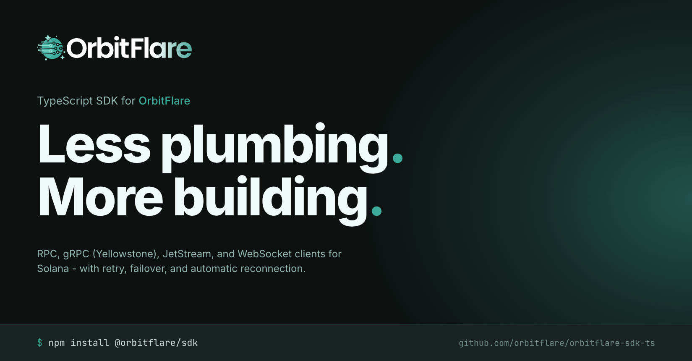

<p align="center">
  
</p>

<p align="center">
  <a href="https://www.npmjs.com/package/@orbitflare/sdk"></a>
  <a href="https://docs.orbitflare.com/sdk/overview"></a>
</p>

# @orbitflare/sdk

TypeScript SDK for [OrbitFlare](https://orbitflare.com) - RPC, Apex transaction landing, gRPC (Yellowstone Geyser), JetStream, and WebSocket clients for Solana.

## Install

```bash
npm install @orbitflare/sdk
```

The RPC client works out of the box. Add only the peer dependencies for the transports you actually use:

```bash
npm install ws            # WebSocket subscriptions
npm install @grpc/grpc-js # gRPC streaming (Yellowstone, JetStream)
npm install yaml          # YAML stream config files
```

## RPC

```ts
import { RpcClientBuilder } from '@orbitflare/sdk';

const client = new RpcClientBuilder()
  .url('http://ny.rpc.orbitflare.com')
  .commitment('confirmed')
  .build();

const slot = await client.getSlot();
const balance = await client.getBalance('CKs1E69a2e9TmH4mKKLrXFF8kD3ZnwKjoEuXa6sz9WqX');
const { blockhash, lastValidBlockHeight } = await client.getLatestBlockhash();

const inflation = await client.request('getInflationRate', []);

const raw = await client.requestRaw(
  '{"jsonrpc":"2.0","id":1,"method":"getHealth","params":[]}',
);
```

### Typed helpers

| Method | Returns |
|---|---|
| `getSlot()` | Current slot (`number`) |
| `getBalance(address)` | Lamports (`number`) |
| `getAccountInfo(address)` | Account data or `null` |
| `getMultipleAccounts(addresses)` | Array of accounts (auto-chunks to 100) |
| `getLatestBlockhash()` | `{ blockhash, lastValidBlockHeight }` |
| `getTransaction(signature)` | Full transaction with metadata |
| `getSignaturesForAddress(address, limit)` | Recent signatures |
| `getProgramAccounts(programId)` | All accounts owned by a program |
| `getRecentPrioritizationFees(addresses)` | Recent priority fees |
| `sendTransaction(txBase64)` | Signature string |
| `simulateTransaction(txBase64)` | Simulation result |
| `getTokenAccountsByOwner(owner, mint?, programId?)` | Token accounts |
| `getTransactionsForAddress(address, options)` | Full transaction history with filters and pagination (OrbitFlare-specific) |
| `request(method, params)` | Any RPC method by name |
| `requestRaw(body)` | Raw JSON-RPC body string |

## DAS API

The Digital Asset Standard methods read NFTs, compressed NFTs, MPL Core assets and SPL tokens. They are on `RpcClient` and use the same endpoint. Requests take the API's own camelCase parameters; responses keep its field names.

```ts
import { RpcClientBuilder, assetName, assetOwner } from '@orbitflare/sdk';

const client = new RpcClientBuilder().url('https://fra.rpc.orbitflare.com').build();

const asset = await client.getAsset('GJfYbfW7gufzFYfm8gFatrUE71wYsjay6FwzDkTa3vaD');
console.log(assetName(asset), assetOwner(asset));

const portfolio = await client.getAssetsByOwner({
  ownerAddress: '86xCnPeV69n6t3DnyGvkKobf9FdN2H9oiVDdaMpo2MMY',
  options: { showFungible: true, showNativeBalance: true },
});

const tokens = await client.searchAssets({
  ownerAddress: '86xCnPeV69n6t3DnyGvkKobf9FdN2H9oiVDdaMpo2MMY',
  tokenType: 'fungible',
});

// Every asset in a collection, page by page.
const all = await client
  .pages('getAssetsByGroup', {
    groupKey: 'collection',
    groupValue: 'CDDyz6MHYY8972DPCXiEeReCxGqJSCbxHnimrvoyWrFF',
  })
  .collectItems();
```

| Method | Returns |
|---|---|
| `getAsset(id, options?)` | `Asset` |
| `getAssetBatch(ids, options?)` | `(Asset \| null)[]` in request order (auto-chunks to 1,000) |
| `getAssetProof(id)` | `AssetProof` for a compressed asset |
| `getAssetProofBatch(ids)` | Proofs keyed by asset ID (auto-chunks to 1,000) |
| `getAssetWithProof(id, options?)` | Asset and proof in one call, for Bubblegum instructions |
| `getAssetsByOwner(req)` | `AssetList`, with `nativeBalance` when asked |
| `getAssetsByGroup(req)` | `AssetList` |
| `getAssetsByCreator(req)` | `AssetList` |
| `getAssetsByAuthority(req)` | `AssetList` |
| `searchAssets(req)` | `AssetList` |
| `getTokenAccounts(req)` | `TokenAccountList`, by owner, mint or both |
| `getNftEditions(req)` | `NftEditions` of a master edition |
| `getSignaturesForAsset(req)` | `AssetSignatures` (`{ signature, instruction }` items) |
| `pages(method, req)` | Walks every page of a list request with `for await`, by cursor or page number |

Helpers: `assetName`, `assetSymbol`, `assetImage`, `assetOwner`, `assetCollection`, `isCompressed` and `proofPath(proof, canopyDepth)`. List requests take `page`, `limit`, `cursor`, `before`, `after` and `sortBy`; use one paging style per request.

## Apex

[Apex](https://apex.orbitflare.com) is OrbitFlare's transaction landing service. You send a signed transaction to the endpoint nearest you, and Apex races it to the upcoming leader over staked validator clients, Jito bundles and the leader TPUs at once. `ApexClient` covers Apex's HTTP routes: JSON-RPC `sendTransaction`, the binary `/send-bin` route, batches, bundles and `getTipAccounts`.

```ts
import { ApexClientBuilder, RpcClientBuilder, pickApexTipAccount, waitForConfirmation } from '@orbitflare/sdk';

const apex = new ApexClientBuilder()
  .region('fra')
  .fallbackRegion('ams')
  .apiKey(process.env.ORBITFLARE_APEX_API_KEY!)
  .build();

const tipAccount = pickApexTipAccount(await apex.getTipAccounts());

const signature = await apex.sendTransactionBinary(signedTransactionBytes);

const solana = new RpcClientBuilder().url('http://fra.rpc.orbitflare.com').build();
const slot = await waitForConfirmation(solana, signature);
```

The client takes signed wire bytes (`Uint8Array`, `Buffer`, or the bytes from `getTransactionEncoder().encode()` in `@solana/kit`), so it works with any Solana library. Legacy, v0 and v1 transactions are all accepted, v1 up to 4096 bytes.

### Tips

Every transaction carries exactly one top-level SystemProgram transfer to one of the published tip accounts, at or above your key's floor (`APEX_MIN_TIP_LAMPORTS`, 0.001 SOL on the standard tier), with the tip account as a static account key rather than through a lookup table. The tip is only paid when the transaction lands. With `@solana/kit`:

```ts
import { address, lamports } from '@solana/kit';
import { getTransferSolInstruction } from '@solana-program/system';
import { APEX_MIN_TIP_LAMPORTS } from '@orbitflare/sdk';

const tip = getTransferSolInstruction({
  source: payer,
  destination: address(tipAccount),
  amount: lamports(BigInt(APEX_MIN_TIP_LAMPORTS)),
});
```

With `@solana/web3.js`, the same tip is `SystemProgram.transfer({ fromPubkey, toPubkey: new PublicKey(tipAccount), lamports: APEX_MIN_TIP_LAMPORTS })`.

### Methods

| Method | Returns |
|---|---|
| `sendTransactionBinary(tx, opts?)` | Signature. Raw bytes to `/send-bin`, the cheapest HTTP path |
| `sendTransaction(tx, opts?)` | Signature. JSON-RPC `sendTransaction`, base64 in JSON |
| `sendBatch(txs, opts?)` | `{ attempted, accepted, rejected, results }` for up to 16 transactions |
| `sendBundle(txs)` | `{ bundleId, signatures }` for 1 to 4 transactions that land in order, all or nothing |
| `getBundleStatuses(bundleIds)` | `Pending`, `Landed` with the slot, `Failed` or `Invalid` per bundle |
| `getTipAccounts()` | The tip accounts this endpoint accepts |
| `ping()` | Resolves once the endpoint answers, and keeps the connection warm |

`opts` takes `mevProtect` (skip leaders on OrbitFlare's Shield blocklist) and `maxRetries` (the retry budget handed to validator clients). Both can also be set once on the builder with `.mevProtect(true)` and `.maxRetries(n)`.

Helpers: `apexClientPubkey(apiKey)` returns the public key your Apex key derives to, which should match the one shown next to the key on your dashboard. `waitForConfirmation(rpc, signature)` polls any Solana RPC until the transaction is confirmed. `fetchApexVaults(rpc)` lists the tip program's vaults on chain, for verifying a published account.

### Regions

`fra`, `ams`, `dub`, `lon`, `nyc`, `slc`, `sgp`, `tyo`, `sqq`, or `global` for the nearest endpoint. `.region()` picks one, `.fallbackRegion()` adds failover targets, and `.url()` takes a full URL. Without either, the builder reads `ORBITFLARE_APEX_URL` or `ORBITFLARE_APEX_REGION` and defaults to `fra`.

### Errors and retries

A rejection from Apex is an `OrbitflareError` with kind `apex`, carrying the HTTP status, Apex's label (`unauthorized`, `below_floor`, `no_tip`, `malformed`, `busy`) and its message. JSON-RPC rejections keep kind `rpc` with the JSON-RPC code. Rejections are returned straight away and never retried or failed over, since every endpoint would give the same answer. Unreachable endpoints, timeouts and 429s fail over to the next endpoint. By default a send is not retried on the same endpoint; pass `.retry()` to change that.

```ts
try {
  await apex.sendTransactionBinary(tx);
} catch (e) {
  if (e instanceof OrbitflareError && e.kind === 'apex') {
    console.log(e.apex?.label, e.apex?.message);
  }
}
```

A returned signature means Apex accepted the transaction and is racing it to the leaders. It does not mean it landed: confirm with `waitForConfirmation` or `getSignatureStatuses`.

Apex's HTTP routes are plain HTTP, so the key and transactions are readable on the network path. Send from a network you trust, or use the QUIC transport in the Rust ([`orbitflare-apex`](https://crates.io/crates/orbitflare-apex)) or Go ([`orbitflare-apex-go`](https://github.com/orbitflare/orbitflare-apex-go)) clients, where the key never leaves your machine. Node has no stable QUIC support yet, so this SDK uses HTTP.

## gRPC (Yellowstone Geyser)

Subscribe using a YAML config file:

```yaml
# grpc.yml
transactions:
  pumpfun:
    vote: false
    failed: false
    account_include:
      - "6EF8rrecthR5Dkzon8Nwu78hRvfCKubJ14M5uBEwF6P"

commitment: confirmed
```

```ts
import { GeyserClientBuilder } from '@orbitflare/sdk/grpc';

const client = new GeyserClientBuilder()
  .url('http://ny.rpc.orbitflare.com:10000')
  .build();

const stream = client.subscribeYaml('grpc.yml');

for await (const update of stream) {
  if (update.transaction) {
    console.log(`slot=${update.transaction.slot}`);
  }
}
```

The YAML format supports `${ENV_VAR}` expansion. You can also call `client.subscribe(request)` with a programmatically constructed `SubscribeRequest`.

### Typed filters

Build the request programmatically with the typed builder instead of YAML:

```ts
import {
  AccountFilter,
  Commitment,
  GeyserClientBuilder,
  Lamports,
  Memcmp,
  SlotFilter,
  SubscribeRequestBuilder,
  TransactionFilter,
} from '@orbitflare/sdk/grpc';

const request = new SubscribeRequestBuilder()
  .transactions(
    'pumpfun',
    new TransactionFilter()
      .vote(false)
      .failed(false)
      .accountInclude(['6EF8rrecthR5Dkzon8Nwu78hRvfCKubJ14M5uBEwF6P'])
      .accountRequired(['So11111111111111111111111111111111111111112']),
  )
  .accounts(
    'wsol-token-accounts',
    new AccountFilter()
      .owner(['TokenkegQfeZyiNwAJbNbGKPFXCWuBvf9Ss623VQ5DA'])
      .datasize(165)
      .memcmp(Memcmp.base58(0, 'So11111111111111111111111111111111111111112'))
      .lamports(Lamports.gt(0)),
  )
  .slots('slots', new SlotFilter().filterByCommitment(true))
  .commitment(Commitment.Confirmed)
  .build();

const stream = client.subscribe(request);
```

`client.subscribe(request)` also accepts a raw `SubscribeRequest` if you'd rather construct it by hand.

### Block footers

Alpenglow block footers arrive as their own `blockFooter` update as soon as the validator reports them, without waiting for the block. Join them with other per-block updates on `(slot, bankId)`. Certificates are opt-in, and their BLS signatures are not verified:

```ts
import {
  BlockFooterFilter,
  Commitment,
  SubscribeRequestBuilder,
} from '@orbitflare/sdk/grpc';

const request = new SubscribeRequestBuilder()
  .blockFooter('footers', new BlockFooterFilter().includeCertificates(true))
  .commitment(Commitment.Processed)
  .build();

for await (const update of client.subscribe(request)) {
  const footer = update.blockFooter;
  if (footer) {
    console.log(`slot=${footer.slot} bankId=${footer.bankId} finalCert=${footer.blockFinalCert !== undefined}`);
  }
}
```

### Resuming after a reconnect

`subscribe` sends the same request on every reconnect. `subscribeWith` builds the request for each connection instead, so a reconnect can resume from where the stream left off and pick up your current filters. The callback gets the endpoint, the attempt number, whether this is a reconnect, and the highest slot the stream has seen:

```ts
const JUPITER = 'JUP6LkbZbjS1jKKwapdHNy74zcZ3tLUZoi5QNyVTaV4';
const PUMP = '6EF8rrecthR5Dkzon8Nwu78hRvfCKubJ14M5uBEwF6P';

const stream = client.subscribeWith((info) => ({
  ...new SubscribeRequestBuilder()
    .transactions('swaps', new TransactionFilter().vote(false).accountInclude([JUPITER]))
    .commitment(Commitment.Confirmed)
    .build(),
  fromSlot: info.lastSlot === undefined ? undefined : info.lastSlot - 32n,
}));
```

Resume a few slots back rather than at `lastSlot + 1`: the last slot may have been cut off part way through, and the replay sends its remaining updates again, so deduplicate by signature.

When a request sets `fromSlot`, the stream first asks the server how far back it can replay. A slot older than that starts at the oldest available one, and a server without replay starts live, instead of failing the subscription. Both are reported as connection events (below).

### Changing filters on a live stream

Yellowstone applies a new request on an open stream in place of the previous one, so filters can change without reconnecting and without missing anything in between. `update` sends one; `handle()` gives a handle that can be passed around:

```ts
const handle = stream.handle();
handle.update(
  new SubscribeRequestBuilder()
    .transactions('swaps', new TransactionFilter().vote(false).accountInclude([JUPITER, PUMP]))
    .build(),
);
```

`fromSlot` is ignored on an update. A stream opened with `subscribe` keeps the updated request for later reconnects; one opened with `subscribeWith` calls its callback, which should reflect the change.

## JetStream

```yaml
# jetstream.yml
transactions:
  raydium:
    account_include:
      - "675kPX9MHTjS2zt1qfr1NYHuzeLXfQM9H24wFSUt1Mp8"
```

```ts
import { JetstreamClientBuilder } from '@orbitflare/sdk/jetstream';

const client = new JetstreamClientBuilder()
  .url('http://ny.jetstream.orbitflare.com')
  .build();

const stream = client.subscribeYaml('jetstream.yml');

for await (const update of stream) {
  if (update.transaction) {
    console.log(`slot=${update.transaction.slot}`);
  }
}
```

Or build the request with the typed builder:

```ts
import {
  JetstreamClientBuilder,
  SubscribeRequestBuilder,
  TransactionFilter,
} from '@orbitflare/sdk/jetstream';

const request = new SubscribeRequestBuilder()
  .transactions(
    'pumpfun',
    new TransactionFilter()
      .accountInclude(['6EF8rrecthR5Dkzon8Nwu78hRvfCKubJ14M5uBEwF6P'])
      .accountRequired(['So11111111111111111111111111111111111111112']),
  )
  .build();

const stream = client.subscribe(request);
```

### JetStream v2

v2 (`@orbitflare/sdk/jetstream/v2`) runs on the same endpoint and auth as v1 and is fully additive. Filters are managed at runtime over a bidirectional stream (no reconnect to change them), every response carries a monotonic `sequence` for gap detection, slot lifecycle events are a separate stream, and transactions can opt into enrichment (fee payer, program ids, compute-unit price, loaded address-table addresses, and more).

```ts
import { JetstreamClientBuilder, TransactionFilter } from '@orbitflare/sdk/jetstream/v2';

const client = new JetstreamClientBuilder()
  .url('http://slc.jetstream.orbitflare.com')
  .fallbackUrl('http://ams.jetstream.orbitflare.com')
  .build();

console.log(`version=${await client.getVersion()}`);

const filter = new TransactionFilter()
  .accountInclude(['6EF8rrecthR5Dkzon8Nwu78hRvfCKubJ14M5uBEwF6P'])
  .includeEnrichment(true)
  .withId('pumpfun');

const stream = client.subscribeTransactions([filter]);

for await (const resp of stream) {
  if (resp.transaction) {
    const tx = resp.transaction.transaction;
    if (tx) {
      console.log(`seq=${resp.sequence} slot=${tx.slot} cuPrice=${tx.computeUnitPrice}`);
    }
  } else if (resp.filterValidation) {
    console.log(`filter ${resp.filterValidation.filterId} accepted=${resp.filterValidation.accepted}`);
  }
}
```

Add or remove filters on a live stream without reconnecting:

```ts
const handle = stream.handle();
handle.addFilters([
  new TransactionFilter().accountInclude(['675kPX9MHTjS2zt1qfr1NYHuzeLXfQM9H24wFSUt1Mp8']).withId('raydium'),
]);
handle.removeFilters(['pumpfun']);
```

Slot lifecycle events are a separate server stream:

```ts
const slots = client.subscribeSlots();

for await (const event of slots) {
  console.log(`slot=${event.slot} status=${event.status}`);
}
```

Opt into Alpenglow block footers on the same stream. They arrive as `SLOT_STATUS_BLOCK_FOOTER` events, at most once per slot, and are not ordered relative to `SLOT_STATUS_COMPLETE`. The certificates' BLS signatures are not verified, so treat a footer as the leader's claim, not proof of finality:

```ts
import { SlotStatus } from '@orbitflare/sdk/jetstream/v2';

for await (const event of client.subscribeSlotsWithBlockFooters()) {
  if (event.status === SlotStatus.SLOT_STATUS_BLOCK_FOOTER && event.blockFooter) {
    console.log(`slot=${event.blockFooter.slot} bankHash=${Buffer.from(event.blockFooter.bankHash).toString('hex')}`);
  }
}
```

## WebSocket

```ts
import { WsClientBuilder } from '@orbitflare/sdk/ws';

const client = await new WsClientBuilder()
  .url('ws://ny.rpc.orbitflare.com')
  .build();

const sub = await client.slotSubscribe();

while (true) {
  const slot = await sub.next();
  if (slot === undefined) break;
  console.log(slot);
}
```

Subscription types: `accountSubscribe`, `logsSubscribe`, `slotSubscribe`, `signatureSubscribe`. All auto-resubscribe on reconnect.

## Endpoint failover

All clients support multiple endpoints with automatic failover and health tracking.

```ts
const client = new RpcClientBuilder()
  .urls([
    'http://ny.rpc.orbitflare.com',
    'http://fra.rpc.orbitflare.com',
    'http://ams.rpc.orbitflare.com',
  ])
  .build();
```

Failing endpoints are quarantined with exponential cooldown (10s, 20s, 40s, max 60s) and automatically retried once the cooldown expires. Healthy endpoints are always preferred.

## Retry

RPC calls retry on transient errors (5xx, 429, connection resets, Solana error codes -32005, -32007, -32014, -32015, -32016) with exponential backoff before failing over to the next endpoint. 429 responses with a `Retry-After` header are respected.

gRPC, JetStream, and WebSocket connections use active ping/pong to detect dead connections. Configurable via the builder:

```ts
const client = new GeyserClientBuilder()
  .url('http://ny.rpc.orbitflare.com:10000')
  .pingIntervalSecs(15)   // send a ping every 15s (default: 10)
  .maxMissedPongs(5)      // kill connection after 5 missed pongs (default: 3)
  .build();
```

All three streaming clients reconnect automatically on disconnection. WebSocket also re-subscribes all active subscriptions after reconnecting. A gRPC or JetStream request the server rejects as invalid, unauthenticated, forbidden or unimplemented ends the stream with that error instead of reconnecting, and only a connection that delivered a message resets the retry count.

Configure retry behavior:

```ts
import { RpcClientBuilder } from '@orbitflare/sdk';

const client = new RpcClientBuilder()
  .url('http://ny.rpc.orbitflare.com')
  .retry({
    initialDelayMs: 200,
    maxDelayMs: 15_000,
    multiplier: 2.0,
    maxAttempts: 5,
  })
  .build();
```

### Connection events

Reconnects are invisible in the update stream itself. Every gRPC and JetStream stream (v1 and v2, transactions and slots) also reports its connection lifecycle, for health checks, metrics, or deciding a gap needs backfilling:

```ts
for await (const event of stream.events()) {
  switch (event.type) {
    case 'connecting':
      console.log(`connecting to ${event.endpoint} (try ${event.attempt})`);
      break;
    case 'connected':
      console.log(`streaming from ${event.endpoint}`);
      break;
    case 'disconnected':
      console.log(
        event.retryInMs === undefined
          ? `${event.endpoint} dropped (${event.error}); giving up`
          : `${event.endpoint} dropped (${event.error}); retrying in ${event.retryInMs}ms`,
      );
      break;
    case 'replayClamped':
      console.log(`slots ${event.requested}..${event.available} are no longer replayable`);
      break;
    case 'replayUnavailable':
      console.log(`no replay; started live instead of at ${event.requested}`);
      break;
    case 'lagged':
      console.log(`missed ${event.missed} events`);
      break;
  }
}
```

Events never hold the stream back: a reader that falls behind by more than 256 events gets `lagged` instead. The first call to `events()` also returns what happened before it was called. `recv()` and `tryRecv()` read one event at a time.

### Connection settings

gRPC and JetStream connections send HTTP/2 keepalive pings every 20 seconds (`.keepaliveSecs()`), use a 5 MiB flow-control window so replays and bursts are not throttled by round-trip time, and accept messages up to 64 MiB (grpc-js's own default of 4 MiB rejects some blocks). Change the limit with `.maxDecodingMessageSize(bytes)` on the builder.

## Environment variables

| Variable | Used by | Purpose |
|---|---|---|
| `ORBITFLARE_LICENSE_KEY` | All clients except Apex | API key: appended to RPC and WebSocket URLs, sent as `x-token` to gRPC and JetStream |
| `ORBITFLARE_RPC_URL` | RPC | Default endpoint if `.url()` is not called |
| `ORBITFLARE_APEX_API_KEY` | Apex | Apex API key, a separate credential from the license key |
| `ORBITFLARE_APEX_URL` | Apex | Default endpoint if `.url()` and `.region()` are not called |
| `ORBITFLARE_APEX_REGION` | Apex | Default region code if no URL is set |
| `ORBITFLARE_WS_URL` | WebSocket | Default endpoint if `.url()` is not called |
| `ORBITFLARE_GRPC_URL` | gRPC | Default endpoint if `.url()` is not called |
| `ORBITFLARE_JETSTREAM_URL` | JetStream | Default endpoint if `.url()` is not called |

## Examples

Seventeen runnable examples live in [`examples/`](./examples), covering every transport in basic and full variants.

```bash
git clone https://github.com/orbitflare/orbitflare-sdk-ts.git
cd orbitflare-sdk-ts
npm install
npm run proto
npm run build

export ORBITFLARE_LICENSE_KEY=ORBIT-...

npm run example:rpc-basic
npm run example:rpc-full
npm run example:das
npm run example:apex-basic
npm run example:apex-full
npm run example:ws-basic
npm run example:ws-full
npm run example:grpc-basic
npm run example:grpc-full
npm run example:grpc-filters
npm run example:grpc-block-footers
npm run example:jetstream-basic
npm run example:jetstream-full
npm run example:jetstream-filters
npm run example:jetstream-v2-basic
npm run example:jetstream-v2-full
npm run example:jetstream-v2-slots
```

The Apex examples send real tipped transfers on mainnet. They read `ORBITFLARE_APEX_API_KEY`, `KEYPAIR_PATH` (a Solana CLI keypair file, default `payer.json`), `SOLANA_RPC_URL`, and optionally `TO` (default: the payer itself), `LAMPORTS` (default 1000) and `ORBITFLARE_APEX_REGION`. `apex-full` sends a legacy transaction over `/send-bin`, a v1 transaction over JSON-RPC and a batch of two, then shows a below-floor tip being refused. Each landed transfer costs the 0.001 SOL tip plus fees.
